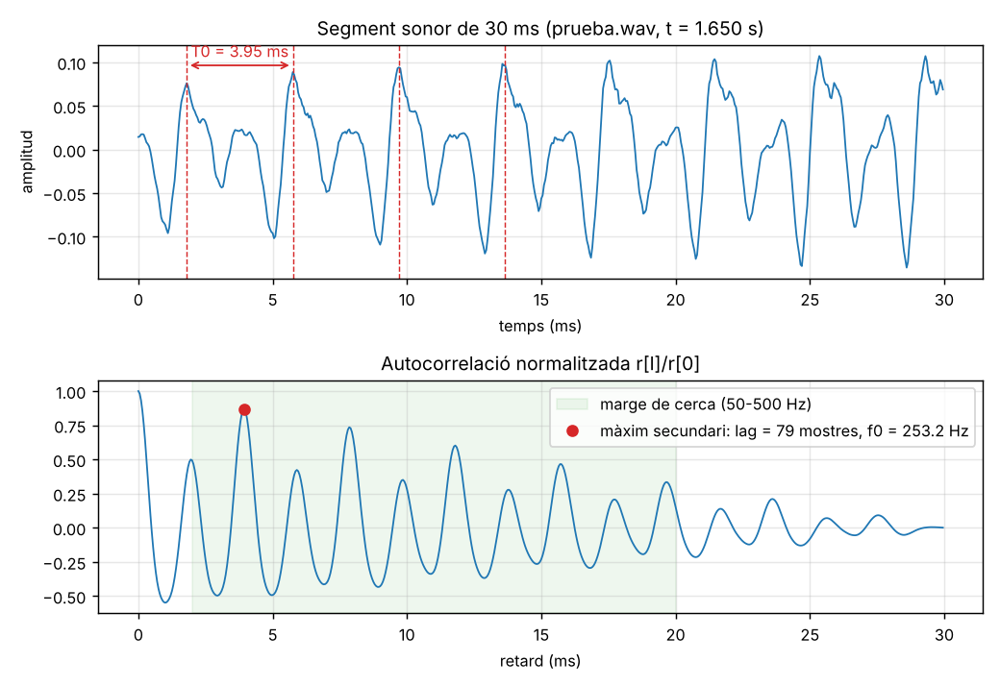
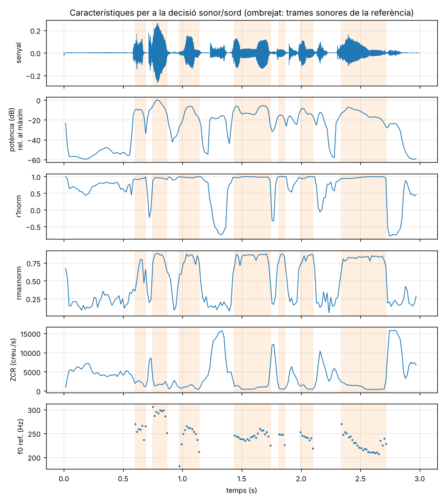
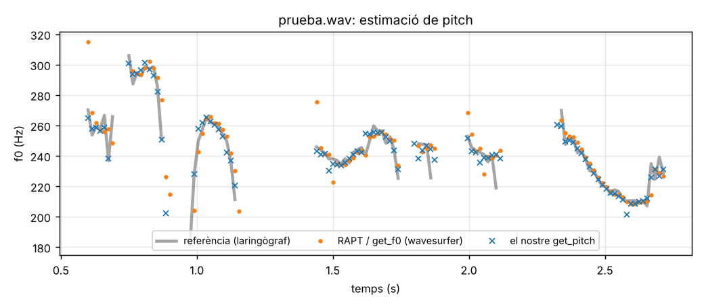
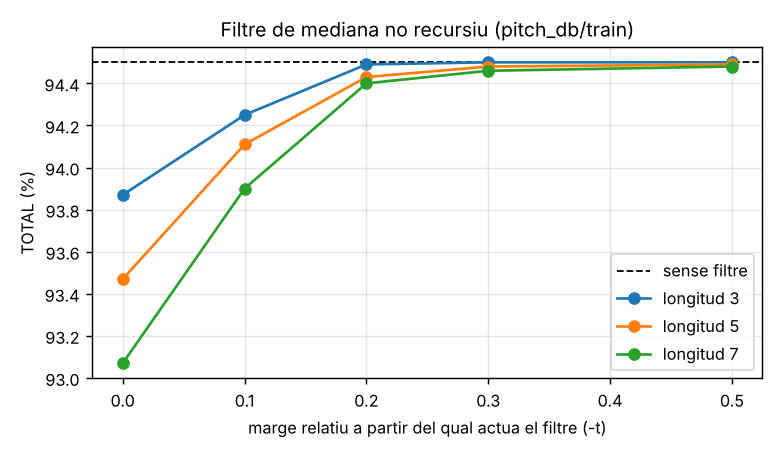

PAV - P3: estimación de pitch
=============================

Esta práctica se distribuye a través del repositorio GitHub [Práctica 3](https://github.com/albino-pav/P3).
Siga las instrucciones de la [Práctica 2](https://github.com/albino-pav/P2) para realizar un `fork` de la
misma y distribuir copias locales (*clones*) del mismo a los distintos integrantes del grupo de prácticas.

Recuerde realizar el *pull request* al repositorio original una vez completada la práctica.

Ejercicios básicos
------------------

- Complete el código de los ficheros necesarios para realizar la estimación de pitch usando el programa
  `get_pitch`.

   * Complete el cálculo de la autocorrelación e inserte a continuación el código correspondiente.

     L'autocorrelació es calcula amb la FFT (teorema de Wiener-Khinchin): és la transformada inversa de
     |X(k)|². La trama s'omple amb zeros fins a una longitud M ≥ N + L (potència de 2) per evitar l'aliasing
     de la correlació circular. El resultat és el mateix que el de la suma directa, però el cost passa de
     O(N·L) a O(M log M): amb N = 600 i L = 401 són unes 240.000 multiplicacions per trama amb la suma
     directa, i unes 40.000 amb dues FFT de M = 1024. Fitxer `src/get_pitch/pitch_analyzer.cpp`:

     ```cpp
     void PitchAnalyzer::autocorrelation(const vector<float> &x, vector<float> &r) const {
       unsigned int M = fftLen;
       vector<float> xp(M, 0.0F), X(M), p(M, 0.0F), rr(M);
       copy(x.begin(), x.end(), xp.begin());
       fft->do_fft(X.data(), xp.data());
       p[0] = X[0] * X[0];
       p[M/2] = X[M/2] * X[M/2];
       for (unsigned int k = 1; k < M/2; ++k)
         p[k] = X[k] * X[k] + X[M/2 + k] * X[M/2 + k];  // |X(k)|^2
       fft->do_ifft(p.data(), rr.data());
       fft->rescale(rr.data());
       for (unsigned int l = 0; l < r.size(); ++l)
         r[l] = rr[l];
       if (r[0] <= 0.0F) r[0] = 1e-10;
     }
     ```

     La primera versió, abans d'optimitzar-la, era la suma directa:

     ```cpp
     for (unsigned int l = 0; l < r.size(); ++l) {
       r[l] = 0.0F;
       for (unsigned int n = 0; n < x.size()-l; ++n)
         r[l] += x[n]*x[n+l];
     }
     ```

   * Inserte una gŕafica donde, en un *subplot*, se vea con claridad la señal temporal de un segmento de
     unos 30 ms de un fonema sonoro y su periodo de pitch; y, en otro *subplot*, se vea con claridad la
	 autocorrelación de la señal y la posición del primer máximo secundario.

	 NOTA: es más que probable que tenga que usar Python, Octave/MATLAB u otro programa semejante para
	 hacerlo. Se valorará la utilización de la biblioteca matplotlib de Python.

     Gràfica feta amb matplotlib (`scripts/grafiques.py`). És una trama sonora de `prueba.wav` a t = 1,65 s.
     El període de pitch és de 3,95 ms (79 mostres a 20 kHz), i el primer màxim secundari de
     l'autocorrelació és exactament en aquest retard (f0 = 253 Hz; la referència diu 260 Hz):

     

   * Determine el mejor candidato para el periodo de pitch localizando el primer máximo secundario de la
     autocorrelación. Inserte a continuación el código correspondiente.

     Busquem el màxim de r[l] entre `npitch_min` (període de 500 Hz) i `npitch_max` (període de 50 Hz).
     Fem servir l'autocorrelació esbiaixada, que atenua els retards llargs i així evita trobar el doble del
     període (errors de meitat de pitch):

     ```cpp
     vector<float>::const_iterator iRMax = max_element(r.begin() + npitch_min, r.begin() + npitch_max);
     unsigned int lag = iRMax - r.begin();
     ff.rmaxnorm = r[lag] / r[0];
     ```

     Després el valor s'afina (vegeu els exercicis d'ampliació): primer amb interpolació parabòlica sobre
     l'autocorrelació no esbiaixada r[l]/(N-l), i després amb correlació normalitzada sobre segments curts.

   * Implemente la regla de decisión sonoro o sordo e inserte el código correspondiente.

     La primera versió fa servir tres llindars: la potència de la trama respecte a la trama més forta del
     fitxer (així no depèn del nivell de gravació), r1norm i rmaxnorm:

     ```cpp
     bool PitchAnalyzer::unvoiced(float pot, float r1norm, float rmaxnorm) const {
       if (pot - pot_ref < pot_threshold) return true;
       if (r1norm < r1norm_threshold) return true;
       if (rmaxnorm < rmaxnorm_threshold) return true;
       return false;
     }
     ```

     Amb els millors llindars (-24 dB, 0,5 i 0,4) dona un 90,72 % a `pitch_db/train`. La versió final fa
     servir un classificador de regressió logística entrenat amb la base de dades (vegeu més avall), que
     arriba al 94,50 %.

   * Puede serle útil seguir las instrucciones contenidas en el documento adjunto `código.pdf`.

- Una vez completados los puntos anteriores, dispondrá de una primera versión del estimador de pitch. El 
  resto del trabajo consiste, básicamente, en obtener las mejores prestaciones posibles con él.

  * Utilice el programa `wavesurfer` para analizar las condiciones apropiadas para determinar si un
    segmento es sonoro o sordo. 
	
	  - Inserte una gráfica con la estimación de pitch incorporada a `wavesurfer` y, junto a ella, los 
	    principales candidatos para determinar la sonoridad de la voz: el nivel de potencia de la señal
		(r[0]), la autocorrelación normalizada de uno (r1norm = r[1] / r[0]) y el valor de la
		autocorrelación en su máximo secundario (rmaxnorm = r[lag] / r[0]).

		Puede considerar, también, la conveniencia de usar la tasa de cruces por cero.

	    Recuerde configurar los paneles de datos para que el desplazamiento de ventana sea el adecuado, que
		en esta práctica es de 15 ms.

      Hem fet la gràfica amb Python en lloc de `wavesurfer`, amb el mateix desplazament de 15 ms. Les
      característiques són les que calcula el programa (`get_pitch -F fitxer`), i la zona ombrejada són les
      trames sonores de la referència:

      

      A la vista de la gràfica:

      * **Potència.** El silenci és a uns -55 dB respecte al màxim i els segments sonors estan entre 0 i
        -25 dB. Però algunes consonants sordes (com la de t = 1,3 s) també tenen força energia, així que la
        potència sola no n'hi ha prou.
      * **r1norm.** Als segments sonors és gairebé 1 (senyal de baixa freqüència). A les fricatives sordes
        baixa fins a -0,7, però al silenci inicial també és alta (0,5-0,8), perquè el soroll de fons és de
        baixa freqüència. Per tant, cal combinar-la amb la potència.
      * **rmaxnorm.** És la que millor separa: més de 0,75 als segments sonors i menys de 0,3 a la resta.
        Els errors es concentren a les transicions, on la trama és mig sonora i mig sorda.
      * **ZCR.** Molt baixa als sonors (unes 500 creuaments/s) i molt alta a les fricatives sordes (més de
        10.000 creuaments/s). Complementa bé la potència.

      - Use el estimador de pitch implementado en el programa `wavesurfer` en una señal de prueba y compare
	    su resultado con el obtenido por la mejor versión de su propio sistema. Inserte una gráfica
		ilustrativa del resultado de ambos estimadores.

        Tenga en cuenta que `wavesurfer` usa un desplazamiento de ventana que no tiene por qué coincidir
        con el de su programa. Ajústelo convenientemente para realizar la comparación.
     
		Aunque puede usar el propio Wavesurfer para obtener la representación, se valorará
	 	el uso de alternativas de mayor calidad (particularmente Python).

      L'estimador de `wavesurfer` és el `get_f0` d'ESPS, que implementa l'algorisme RAPT (Talkin, 1995).
      Hem fet servir la mateixa implementació des de Python (`pysptk.rapt`, amb desplaçament de 15 ms i
      marge de 50 a 500 Hz) i hem ajustat l'alineació temporal de les trames (una trama de desplaçament).
      Comparació a `prueba.wav`:

      

      | Estimador | `prueba.wav` | `pitch_db/train` |
      |---|---|---|
      | RAPT / `get_f0` (wavesurfer) | 92,50 % | 91,10 % |
      | El nostre `get_pitch` | 94,24 % | 94,50 % |

      Els dos segueixen bé la referència. RAPT marca com a sonores més trames a l'inici i al final dels
      segments (per exemple, a 0,9 s i a 1,15 s), i hi té valors desviats.
  
  * Optimice los parámetros de su sistema de estimación de pitch e inserte una tabla con las tasas de error
    y el *score* TOTAL proporcionados por `pitch_evaluate` en la evaluación de la base de datos 
	`pitch_db/train`..

    Evolució del sistema (cada fila afegeix una tècnica a l'anterior; els paràmetres de cada fila són els
    òptims per a aquella versió):

    | Versió | Sordes com a sonores | Sonores com a sordes | Errors grossos | Error fi | TOTAL |
    |---|---|---|---|---|---|
    | Codi inicial de classe (`--rmaxnorm 0.6`) | | | | | 84,09 % |
    | Regla de 3 llindars (potència, r1norm, rmaxnorm) | 3,99 % | 10,20 % | 1,47 % | 2,36 % | 90,72 % |
    | + filtre passa-baixos a 350 Hz | 4,73 % | 6,74 % | 0,80 % | 2,26 % | 91,86 % |
    | + center clipping (25 %) | 5,29 % | 5,73 % | 0,82 % | 2,49 % | 91,68 % |
    | Classificador de regressió logística | 2,14 % | 4,33 % | 0,93 % | 2,58 % | 94,16 % |
    | + refinament del període amb segments curts | 2,14 % | 4,33 % | 0,98 % | 2,21 % | 94,50 % |
    | + filtre de mediana (3 trames, marge 30 %) | 2,14 % | 4,33 % | 0,93 % | 2,22 % | **94,50 %** |

    Resultat de `pitch_evaluate` amb la versió final (`scripts/run_get_pitch.sh`):

    ```
    Num. frames:	11200 = 7045 unvoiced + 4155 voiced
    Unvoiced frames as voiced:	151/7045 (2.14 %)
    Voiced frames as unvoiced:	180/4155 (4.33 %)
    Gross voiced errors (+20.00 %):	37/3975 (0.93 %)
    MSE of fine errors:	2.22 %

    ===>	TOTAL:	94.50 %
    ```

Ejercicios de ampliación
------------------------

- Usando la librería `docopt_cpp`, modifique el fichero `get_pitch.cpp` para incorporar los parámetros del
  estimador a los argumentos de la línea de comandos.
  
  Esta técnica le resultará especialmente útil para optimizar los parámetros del estimador. Recuerde que
  una parte importante de la evaluación recaerá en el resultado obtenido en la estimación de pitch en la
  base de datos.

  * Inserte un *pantallazo* en el que se vea el mensaje de ayuda del programa y un ejemplo de utilización
    con los argumentos añadidos.

    Missatge d'ajuda (`get_pitch --help`):

    ```

    get_pitch - Pitch Estimator 

    Usage:
        get_pitch [options] <input-wav> <output-txt>
        get_pitch (-h | --help)
        get_pitch --version

    Options:
        -v, --voiced FLOAT    Llindar de probabilitat de sonoritat del classificador logístic
                              (0 = fer servir la regla de llindars -m, -1, -p) [default: 0.55]
        -m, --rmaxnorm FLOAT  Llindar de r[lag]/r[0] per a decisió sord/sonor [default: 0.4]
        -1, --r1norm FLOAT    Llindar de r[1]/r[0] per a decisió sord/sonor [default: 0.0]
        -p, --pot FLOAT       Llindar de potència (dB) relatiu a la trama més forta [default: -100]
        -c, --clip FLOAT      Nivell de center clipping (fracció del màxim de la trama) [default: 0.25]
        -l, --lowpass FLOAT   Freqüència de tall del filtre passa-baixos en Hz (0 = sense filtre) [default: 350]
        -w, --median INT      Longitud del filtre de mediana (1 = sense filtre) [default: 3]
        -t, --medtol FLOAT    El filtre de mediana només canvia el valor si s'allunya de la mediana
                              més d'aquesta fracció (0 = sempre) [default: 0.3]
        -f, --framelen FLOAT  Longitud de la trama en ms [default: 30]
        -o, --offset FLOAT    Desplaçament del centre de la trama en ms [default: 0]
        -r, --refine FLOAT    Longitud (ms) dels segments per refinar el període amb correlació
                              normalitzada (0 = sense refinament) [default: 10]
        -F, --features FILE   Escriu les característiques de cada trama en aquest fitxer
        -H, --hamming         Finestra de Hamming (per defecte, rectangular)
        -h, --help  Show this screen
        --version   Show the version of the project

    Arguments:
        input-wav   Wave file with the audio signal
        output-txt  Output file: ASCII file with the result of the estimation:
                        - One line per frame with the estimated f0
                        - If considered unvoiced, f0 must be set to f0 = 0
    ```

    Exemple d'ús amb els arguments afegits:

    ```
    $ get_pitch --lowpass 350 --clip 0.25 --median 3 --medtol 0.3 prueba.wav prueba.f0
    $ pitch_evaluate prueba.f0ref
    ### Compare prueba.f0ref and prueba.f0
    Num. frames:	200 = 113 unvoiced + 87 voiced
    Unvoiced frames as voiced:	5/113 (4.42 %)
    Voiced frames as unvoiced:	2/87 (2.30 %)
    Gross voiced errors (+20.00 %):	0/85 (0.00 %)
    MSE of fine errors:	2.30 %

    ===>	prueba.f0:	94.24 %
    --------------------------
    ```

    Els valors per defecte són els òptims, de manera que `get_pitch fitxer.wav fitxer.f0` (sense opcions)
    ja fa servir la millor configuració, que és la que s'utilitzarà a l'avaluació cega.

- Implemente las técnicas que considere oportunas para optimizar las prestaciones del sistema de estimación
  de pitch.

  Entre las posibles mejoras, puede escoger una o más de las siguientes:

  * Técnicas de preprocesado: filtrado paso bajo, diezmado, *center clipping*, etc.
  * Técnicas de postprocesado: filtro de mediana, *dynamic time warping*, etc.
  * Métodos alternativos a la autocorrelación: procesado cepstral, *average magnitude difference function*
    (AMDF), etc.
  * Optimización **demostrable** de los parámetros que gobiernan el estimador, en concreto, de los que
    gobiernan la decisión sonoro/sordo.
  * Cualquier otra técnica que se le pueda ocurrir o encuentre en la literatura.

  Encontrará más información acerca de estas técnicas en las [Transparencias del Curso](https://atenea.upc.edu/pluginfile.php/2908770/mod_resource/content/3/2b_PS%20Techniques.pdf)
  y en [Spoken Language Processing](https://discovery.upc.edu/iii/encore/record/C__Rb1233593?lang=cat).
  También encontrará más información en los anexos del enunciado de esta práctica.

  Incluya, a continuación, una explicación de las técnicas incorporadas al estimador. Se valorará la
  inclusión de gráficas, tablas, código o cualquier otra cosa que ayude a comprender el trabajo realizado.

  También se valorará la realización de un estudio de los parámetros involucrados. Por ejemplo, si se opta
  por implementar el filtro de mediana, se valorará el análisis de los resultados obtenidos en función de
  la longitud del filtro.

### Tècniques implementades

**1. Filtre passa-baixos (preprocessat).** Filtre FIR de fase zero (sinc enfinestrada amb Hamming, 81
coeficients, 4 ms). Elimina els formants i deixa només el fonamental i els primers harmònics, de manera que
l'autocorrelació té un pic més clar al període. Hem escombrat la freqüència de tall reentrenant cada vegada el
classificador (validació creuada de 5 blocs sobre `pitch_db/train`):

| Tall (Hz) | 250 | 320 | 350 | 400 | 500 | 600 | 900 |
|---|---|---|---|---|---|---|---|
| TOTAL (validació creuada) | 94,33 % | 94,41 % | 94,37 % | 94,34 % | 94,19 % | 94,14 % | 94,00 % |

Hi ha un altiplà entre 250 i 400 Hz, i hem triat 350 Hz, al mig, per no ajustar-nos massa a aquesta base de dades.

**2. Center clipping (preprocessat).** Les mostres amb |x| < α·max es posen a zero i a la resta se'ls resta el
nivell. El senyal s'assembla més a un tren de deltes (l'excitació glotal) i el pic de l'autocorrelació al
període és més marcat. Un cop aplicat el filtre passa-baixos, l'efecte és petit: amb el classificador, la
validació creuada dona 94,26 % (α = 0), 94,27 % (0,1), 94,37 % (0,25), 94,27 % (0,3) i 94,17 % (0,4). Ens
quedem amb α = 0,25. Sense filtre passa-baixos el clipping empitjora (de 90,72 % a 90,00 % amb la regla de
llindars), perquè el clipping amplifica relativament el soroll d'alta freqüència.

**3. Afinament del període.** L'autocorrelació calculada amb una trama finita és esbiaixada: r[l] queda
atenuada per (N-l)/N, i això desplaça el màxim cap a retards més curts. Al voltant del màxim fem servir
l'autocorrelació no esbiaixada r[l]/(N-l) i una interpolació parabòlica per tenir una precisió inferior a
una mostra.

A més, la trama de 30 ms és necessària per trobar el període amb fiabilitat, però si el pitch varia dins de la
trama el resultat és una mitjana. Per això, un cop tenim el període aproximat T, busquem el desplaçament (dins
de T ± 5 %) que maximitza la correlació normalitzada entre dos segments curts al centre de la trama, separats
aquest desplaçament, i interpolem amb una paràbola. Es fa en dues passades. L'error fi baixa del 2,58 % al
2,21 %:

| Longitud dels segments (`-r`, ms) | 0 (sense) | 4 | 6 | 8 | 10 | 15 | 20 |
|---|---|---|---|---|---|---|---|
| TOTAL | 94,16 % | 94,27 % | 94,45 % | 94,49 % | **94,50 %** | 94,43 % | 94,28 % |

**4. Decisió sonor/sord amb regressió logística (optimització demostrable).** Per a cada trama calculem 8
característiques: potència relativa, r1norm, rmaxnorm, correlació normalitzada al període i ZCR del senyal
filtrat, i potència relativa, r1norm i ZCR del senyal original. El classificador fa servir les de la trama
actual i les de les dues anteriors i les dues posteriors (5 × 8 = 40 pesos i un terme independent):

  P(sonora) = 1 / (1 + exp(-(w · x + b)))

Els pesos s'han entrenat amb `pitch_db/train` (sklearn) i estan escrits a `get_pitch.cpp`. Per comprovar que
el model no està sobreajustat hem fet validació creuada de 5 blocs (entrenant amb 4/5 dels fitxers i
avaluant amb l'altre cinquè): dona un 94,37 %, gairebé igual que amb tota la base de dades (94,50 %). També
millora a `prueba.wav`, que no s'ha fet servir per entrenar (de 91,52 % amb la regla de llindars a 94,24 %).
Llindar de probabilitat (`-v`):

| Llindar `-v` | 0,3 | 0,4 | 0,5 | 0,55 | 0,6 | 0,7 | 0,8 |
|---|---|---|---|---|---|---|---|
| TOTAL | 93,64 % | 94,08 % | 94,45 % | **94,50 %** | 94,45 % | 94,34 % | 94,03 % |

**5. Filtre de mediana (postprocessat).** No és recursiu: la mediana es calcula sempre sobre els valors
originals i el resultat s'escriu en un vector nou. Si s'escrivís sobre el mateix vector, els valors ja
filtrats entrarien a la finestra de les trames següents i seria un filtre recursiu. Només es modifiquen
trames sonores, la mediana es calcula amb les veïnes sonores, i el valor només es canvia si s'allunya de la
mediana més d'un marge relatiu (`-t`). Si no hi ha error, el filtre no toca el valor, perquè la mediana
sempre empitjora l'estimació fina:



| Longitud \ marge (`-t`) | 0 (sempre) | 0,1 | 0,2 | 0,3 | 0,5 |
|---|---|---|---|---|---|
| 1 (sense filtre) | 94,50 % | | | | |
| 3 | 93,87 % | 94,25 % | 94,49 % | **94,50 %** | 94,50 % |
| 5 | 93,47 % | 94,11 % | 94,43 % | 94,48 % | 94,49 % |
| 7 | 93,07 % | 93,90 % | 94,40 % | 94,46 % | 94,48 % |

Aplicat sempre (com un filtre de mediana normal) empitjora més com més llarg és. Amb el marge, l'efecte és
neutre perquè el sistema final ja té molt pocs errors grossos (0,93 %). Ens quedem amb longitud 3 i marge del
30 %.

**6. Escombrat de paràmetres (`cardem-li`).** Com a la P2, l'script `cardem-li` escombra els valors d'un
paràmetre i mostra el TOTAL de cada un. Per exemple:

```
./cardem-li --lowpass 250 300 350 400 600
./cardem-li --medtol 0 0.1 0.2 0.3
```

Les taules d'aquest README s'han fet així.

**Altres tècniques provades que no han millorat:**

* **AMDF i correlació normalitzada per afinar el període:** donen el mateix error fi que l'autocorrelació
  (≈ 2,5 % sense els segments curts).
* **Pic cepstral i AMDF com a característiques del classificador:** només +0,07 punts en validació creuada;
  no compensa la complexitat.
* **Viterbi sobre la decisió sonor/sord** (model de Markov de dos estats que penalitza els canvis) i
  **correcció d'errors d'octava:** no milloren, perquè el classificador ja té en compte les trames veïnes i
  gairebé no hi ha errors d'octava.
* **Nivell de soroll estimat amb les primeres trames** (com a la P2): empitjora una mica; funciona millor la
  potència respecte a la trama més forta.
* **Models no lineals** (gradient boosting, xarxa neuronal petita): en validació creuada guanyen només unes
  tres dècimes respecte a la regressió logística i molt més difícils de justificar i d'implementar en C++.

**Observacions:**

* Els errors que queden són sobretot a les fronteres entre trames sonores i sordes: 28 dels 37 errors
  grossos són en trames de frontera, on la referència del laringògraf és poc fiable.
* Els pesos del classificador i els llindars depenen de la freqüència de mostratge (20 kHz). Amb una altra
  freqüència caldria tornar a entrenar-los.
* En 4 fitxers (rl014, rl016, rl018 i rl020) la referència té una trama més que la resta (la longitud no és
  coherent amb la durada del senyal). `pitch_evaluate` ho compensa sol.
* També hem corregit un error de `wavfile_mono.cpp`: l'estructura `SF_INFO` no s'inicialitzava i, de tant
  en tant, la lectura del fitxer fallava.
   

Evaluación *ciega* del estimador
-------------------------------

Antes de realizar el *pull request* debe asegurarse de que su repositorio contiene los ficheros necesarios
para compilar los programas correctamente ejecutando `make release`.

Con los ejecutables construidos de esta manera, los profesores de la asignatura procederán a evaluar el
estimador con la parte de test de la base de datos (desconocida para los alumnos). Una parte importante de
la nota de la práctica recaerá en el resultado de esta evaluación.
